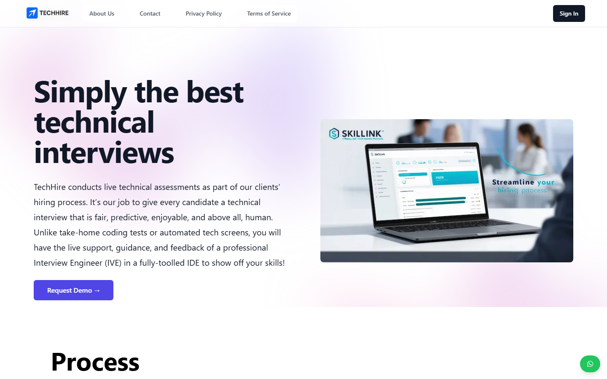
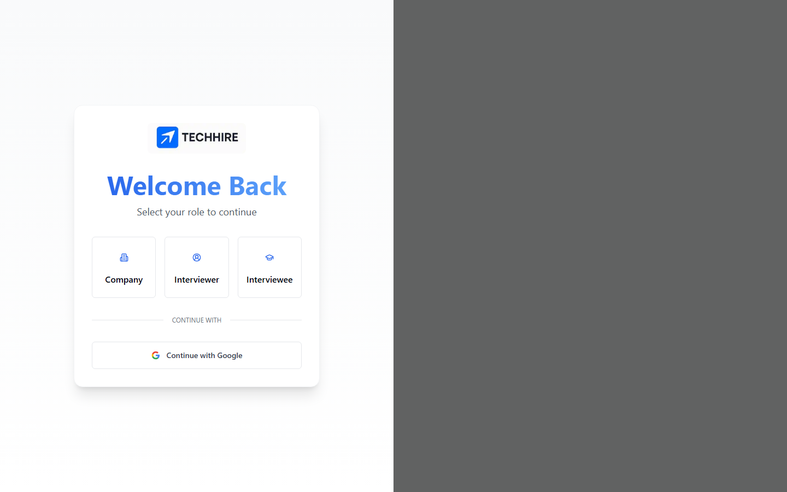
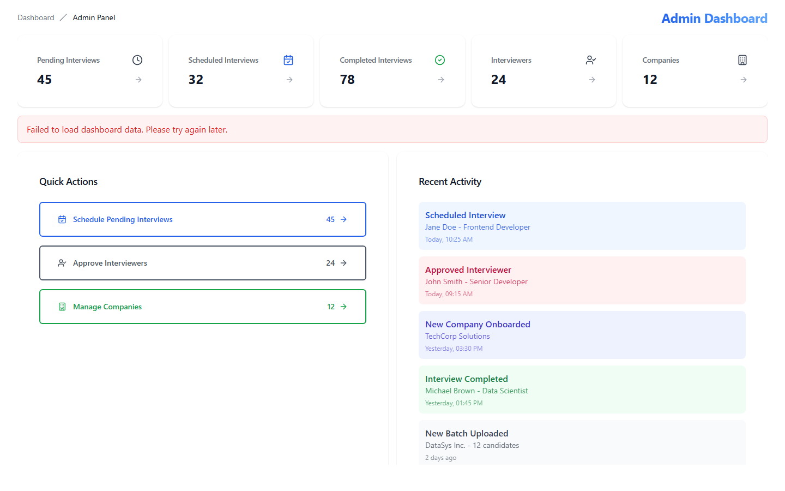
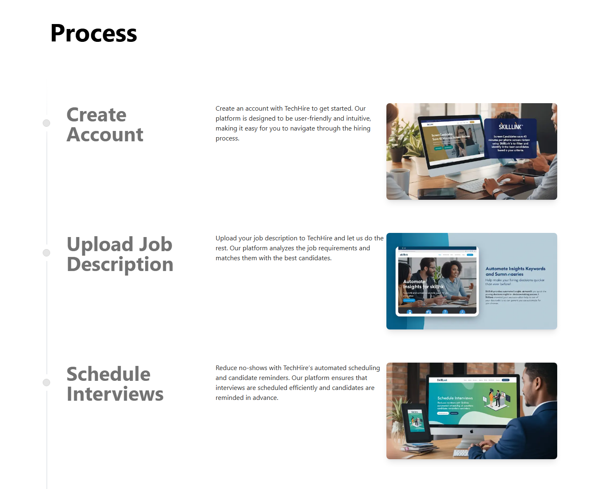
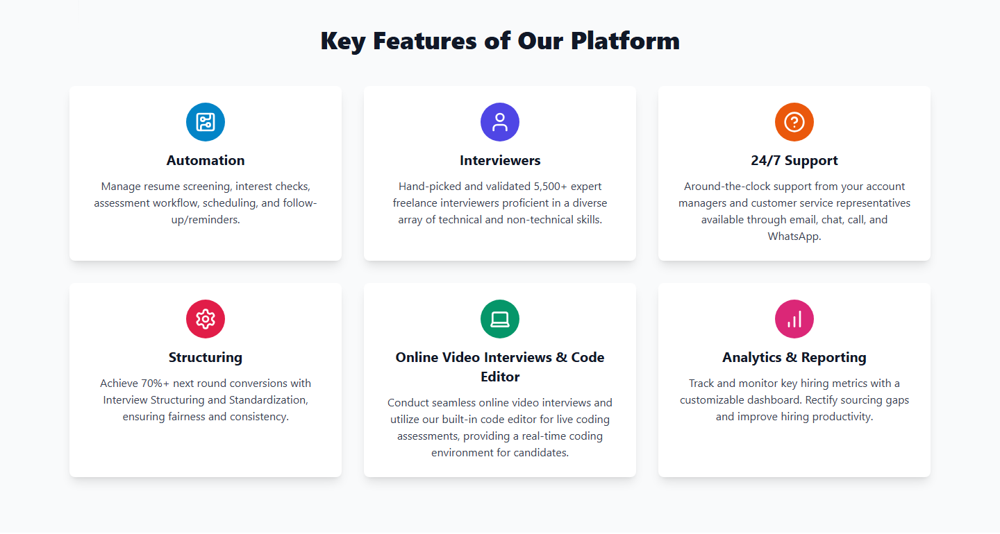
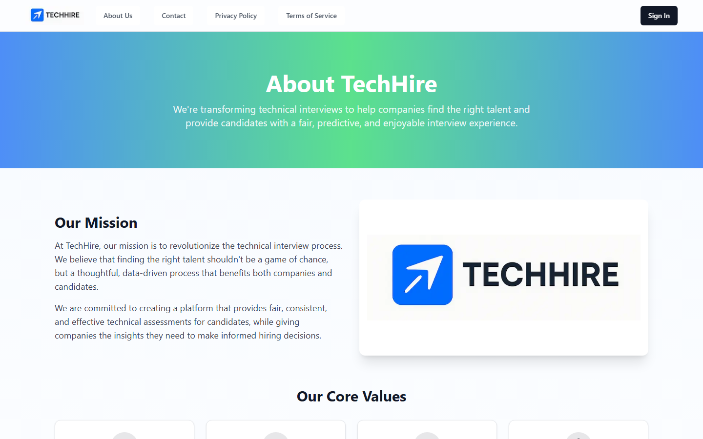

# 🚀 TechHire: Remote Technical Interview Platform

**Final Year Project.** A full-stack SaaS platform where companies hire developers through **live remote technical interviews**. Candidates join a browser-based interview room with **video, chat and a shared code editor**. Interviewers score them against a structured rubric, and admins oversee the whole pipeline.




---

## At a glance (for recruiters)

| | |
|---|---|
| **What it is** | An end-to-end hiring platform for running and assessing technical interviews online |
| **Who uses it** | Four roles: **Companies** (hiring), **Interviewers** (assessing), **Interviewees** (candidates) and **Admins** (platform oversight) |
| **Main problem solved** | Replaces scattered tools (calendar, video call, coding test, feedback forms) with one fair, structured interview workflow |
| **Type** | Full-stack web application (SaaS) |
| **Tech** | Next.js 14 · React · TypeScript · Node.js/Express · Socket.IO · WebRTC (PeerJS) · Prisma · PostgreSQL (Supabase) · NextAuth (Google OAuth) · Tailwind CSS · Monaco Editor · Yjs/Liveblocks · AWS S3 · Docker |
| **Skills shown** | Full-stack architecture, real-time communication, role-based access, relational data modelling, REST API design, sandboxed code execution, collaborative editing, integration testing |

---

## Key features

### 🎥 Live interview room
- **Video, audio and screen sharing** between interviewer and candidate (WebRTC via PeerJS).
- **Real-time chat** and a participant list, synchronised through **Socket.IO**.
- **Host controls.** The interviewer can mute participants or stop a screen share.
- **Interview recording** uploaded to **AWS S3**.

### 💻 Live coding assessment
- A **Monaco** editor (the engine behind VS Code) built into the interview room.
- **Real-time collaborative editing.** Both people see each other's typing live (Yjs + Liveblocks).
- **Sandboxed code execution.** Candidates run their code and see the output instantly, with timeouts and isolation (`vm2`, plus an optional **Piston** Docker service for more languages).

### 🏢 Company workspace
- A company profile, **job descriptions**, and bulk **candidate upload** from spreadsheets (`xlsx`).
- **Interview scheduling.** Candidates are matched to interviewers by **skill score** and **availability slots**.
- A per-candidate view with results and a downloadable **PDF interview report**.

### 🧑‍💼 Interviewer workspace
- Manage **availability slots**, with validation such as a maximum of 5 slots and no duplicates.
- View scheduled interviews and submit **structured feedback**: technical skill, communication, problem solving, code quality and a hire / no-hire decision.
- A **personal statistics** dashboard with charts.

### 🎓 Candidate (interviewee) workspace
- An **interview preparation** area and the candidate's upcoming interviews.

### 🛡️ Admin console
- An overview of **pending, scheduled and completed** interviews.
- Approval and management of **interviewers** and **companies**.

### 🌐 Public website
- Marketing homepage, About, Careers, Contact (stored in the database), FAQs, Documentation, Help Center, and Privacy / Cookie / Terms pages.

### 🔐 Authentication and notifications
- **Google sign-in** (NextAuth) with **role selection**: Company, Interviewer or Interviewee.
- **Email notifications** for interview events (Nodemailer).

## Screenshots

| Sign in by role | Admin dashboard |
|---|---|
|  |  |

**Hiring process: create an account, upload a job, schedule interviews, interview candidates, then report**



**Platform features**



**About page**



## Architecture

```
                 ┌──────────────────────────────────────────────┐
  Browser  ───▶  │  Next.js 14 app  (my-next-app/)              │
  (React UI)     │   • Pages & role dashboards  (App Router)    │
                 │   • REST API routes   src/app/api/*          │──▶ PostgreSQL (Supabase)
                 │   • NextAuth (Google OAuth)                  │      via Prisma ORM
                 └───────────────┬──────────────────────────────┘
                                 │ WebSocket / HTTP
                 ┌───────────────▼──────────────────────────────┐
                 │  Real-time server  (server.js, Node/Express) │
                 │   • Socket.IO  – room events, chat (:3001)   │
                 │   • PeerJS     – WebRTC signalling  (:9000)  │
                 │   • /api/execute – sandboxed JS runner       │
                 └──────────────────────────────────────────────┘
   Also: Liveblocks (collaborative editor) · AWS S3 (recordings) · Piston (Docker, multi-language)
```

**Data model (Prisma):** `User`, `Company`, `Interviewer`, `Interviewee`, `JobDescription`, `Interview`, `CodeSubmission`, `AIEvaluation`, `InterviewFeedback`, `Notification`, `ContactFormResponse`.

## Testing

The project includes an **automated integration-test runner** (`my-next-app/scripts/run-integration-evidence.mjs`). It calls the real API routes and checks business rules such as:

- the slot limit,
- duplicate-slot rejection,
- skill-based interviewer matching,
- booking a slot when an interview is scheduled,
- bulk interview creation,
- spreadsheet column validation.

The latest run is in [`my-next-app/integration-evidence-latest.txt`](my-next-app/integration-evidence-latest.txt), and every test passes.

## Getting started

### Requirements
- **Node.js** 18 or 20 LTS and npm
- A **PostgreSQL** database (for example a free [Supabase](https://supabase.com) project)
- A **Google OAuth** client (for sign-in)
- *Optional:* **Docker** to run the Piston multi-language code runner

### 1. Install
```bash
git clone https://github.com/MalikNazeer1/TechHire.git
cd TechHire
npm run install:all      # installs the root server and the Next.js app
```

### 2. Configure
```bash
cp my-next-app/.env.example my-next-app/.env
```
Then fill in your own database URL, Google OAuth keys, Supabase keys and the other values. Every variable is explained in [`.env.example`](my-next-app/.env.example).

### 3. Set up the database
```bash
cd my-next-app
npx prisma migrate deploy
cd ..
```

### 4. Run
```bash
npm run run:all
```
This starts the real-time server on **:3001** (with PeerJS on **:9000**) and the web app on **http://localhost:3000**.

*Optional:* to run code in multiple languages, start the code runner with `docker compose up -d`.

## Project structure

```
TechHire/
├── server.js                  # Real-time server: Socket.IO, PeerJS, code execution API
├── server-code-executor.js    # Sandboxed code-runner helpers
├── docker-compose.yml         # Piston multi-language code execution service
├── docs/
│   ├── screenshots/
│   └── fyp/                   # Project explanatory notes and demo video script
└── my-next-app/               # Next.js application
    ├── prisma/                # Database schema and migrations
    ├── scripts/               # Integration-test runner
    └── src/
        ├── app/
        │   ├── (dashboard)/   # admin · company · interviewer · interviewee
        │   ├── api/           # REST endpoints (interviews, jobs, auth, execute, recordings, …)
        │   └── Homepage/ …    # Public website pages
        ├── components/        # Video room, chat, code editor, recording, charts, UI kit
        ├── room/              # Interview-room composition
        ├── hooks/ stores/ context/ lib/ utils/
```

## Future improvements
- Add server-side code execution for Python, Java and C++ through the Piston service.
- Production hardening: HTTPS, stricter CORS and rate limiting.
- Accessibility (WCAG) and internationalisation.
